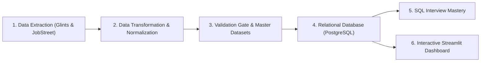

# 🇮🇩 Indonesian Data Job Market Intelligence

Proyek *End-to-End Data Engineering & Business Intelligence* untuk memetakan, menganalisis, dan memvisualisasikan pasar kerja talenta data di Indonesia (*Data Analyst*, *Data Engineer*, *Data Scientist*, dan *Machine Learning & AI*) yang dikumpulkan dari dua platform rekrutmen terkemuka: **Glints** dan **JobStreet**.

---

## 📌 Ringkasan Alur Kerja Proyek (Pipeline)



1. **Ekstraksi Data Multi-Sumber (`notebook/extract_data/`):**
   - Mengambil data lowongan kerja secara terstruktur dari Glints dan JobStreet Indonesia.
   - Penanganan selektif untuk kolom gaji mentah, kualifikasi pendidikan, dan jenjang pengalaman kerja.

2. **Transformasi & Standarisasi (`notebook/transform_data/`):**
   - Pembersihan teks, penanganan nilai hilang, standarisasi lokasi (kota dan provinsi di Indonesia).
   - Klasifikasi kelompok profesi (*Data Analytics & BI*, *Data Engineering*, *Data Science*, *Machine Learning & AI*).
   - Klasifikasi 8 sektor industri nasional (*Information Technology & Software*, *Banking & Financial Services*, *Retail & FMCG*, dll).
   - Ekstraksi dan pemetaan keahlian teknis (*tools & skills*) ke dalam 5 kategori utama.

3. **Konsolidasi Master & Quality Gate (`finalize_data.ipynb`):**
   - Integrasi multi-sumber, deduplikasi tautan/posisi, dan pengujian validasi 9-lapis (100% PASS).
   - Menghasilkan dataset terpadu: `jobs_master` (250 lowongan terstandarisasi) dan `skills_master` (1.061 pemetaan keahlian).

4. **Pemodelan Relasional & Ingestion (`notebook/load_data/load_to_db.ipynb`):**
   - Skema DDL relasional dan view analitik terstruktur di PostgreSQL (`sql/schema.sql` dan `sql/views.sql`).
   - Uji integritas referensial Foreign Key (0 orphan records) dan keunikan Primary Key.

5. **Dashboard Interaktif (`dashboard/app.py`):**
   - Dashboard analitik berbasis Streamlit & Plotly yang dirancang mengikuti prinsip *Visual Hierarchy*, *Grid Alignment*, dan *Cognitive Load Reduction*.

---

## 📁 Struktur Direktori Proyek

```text
analisi_loker_data_indonesia/
├── dashboard/                  # Aplikasi Dashboard Interaktif
│   ├── app.py                  # Entry-point Streamlit Dashboard
│   ├── utils.py                # Utilitas koneksi database & fallback lokal
│   └── README.md               # Panduan penggunaan dashboard
├── notebook/                   # Notebook Jupyter ETL & Analisis
│   ├── extract_data/           # Notebook ekstraksi scraping (Glints & JobStreet)
│   ├── transform_data/         # Notebook transformasi & master validation
│   └── load_data/              # Notebook database ingestion & SQL mastery
├── outputs/                    # Output visualisasi grafik & gambar analitis
├── reports/                    # Laporan ringkasan eksekutif
├── sql/                        # Skrip SQL Relasional
│   ├── schema.sql              # DDL tabel jobs_master & skills_master
│   ├── views.sql               # Analytical views (gaji, skills, industri)
│   └── queries.sql             # Kumpulan query analitik bisnis & interview
├── .env.example                # Template konfigurasi environment database
├── .gitignore                  # Berkas pengecualian Git
└── README.md                   # Dokumentasi utama proyek
```

---

## 🚀 Panduan Memulai Cepat (Quickstart)

### 1. Prasyarat & Instalasi
Pastikan Python 3.10+ telah terinstal, lalu pasang pustaka yang diperlukan:

```bash
pip install -r requirements.txt
# Atau instalasi langsung paket inti:
pip install pandas numpy sqlalchemy psycopg2-binary streamlit plotly python-dotenv
```

### 2. Konfigurasi Lingkungan
Salin `.env.example` menjadi `.env` lalu sesuaikan kredensial basis data PostgreSQL Anda:

```bash
cp .env.example .env
```

### 3. Inisialisasi Database
Jalankan notebook [notebook/load_data/load_to_db.ipynb](file:///C:/Users/Victus%2016/data-project/analisi_loker_data_indonesia/notebook/load_data/load_to_db.ipynb) untuk membuat tabel, indeks, view, dan memuat data bersih ke database.

### 4. Menjalankan Dashboard Streamlit
Untuk membuka dashboard visualisasi interaktif:

```bash
streamlit run dashboard/app.py
```
Akses dashboard di browser Anda pada alamat: `http://localhost:8501`.

---

## 📊 Highlight Temuan Pasar Kerja Talenta Data Indonesia
- **Peran Paling Dibutuhkan:** *Data Analytics & BI* mendominasi **54,0%** pasar kerja, diikuti oleh *Data Engineering* (**20,0%**) dan *Machine Learning & AI* (**17,2%**).
- **Top 5 Keterampilan Teknis Nasional:** SQL (47,2%), Python (40,0%), Microsoft Excel (36,8%), Statistics / Modeling (32,8%), dan Power BI (27,6%).
- **Transparansi Gaji:** Hanya **50,0%** lowongan yang mencantumkan informasi gaji secara transparan, dengan median nasional di angka **Rp 6.750.000** dan penawaran tertinggi mencapai **Rp 35.000.000**.
- **Sektor Paling Agresif Merekrut:** *Information Technology & Software*, *Banking & Financial Services*, serta *Healthcare & Pharmaceuticals*.

---
*Dikembangkan oleh Muhammad Fabhian | 2026*
