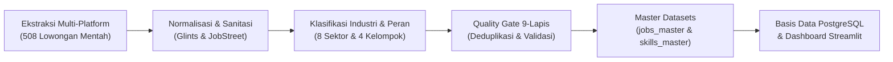
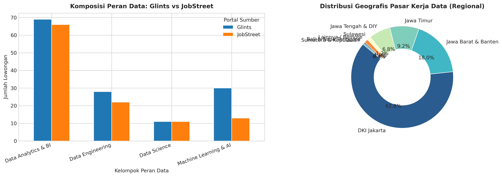
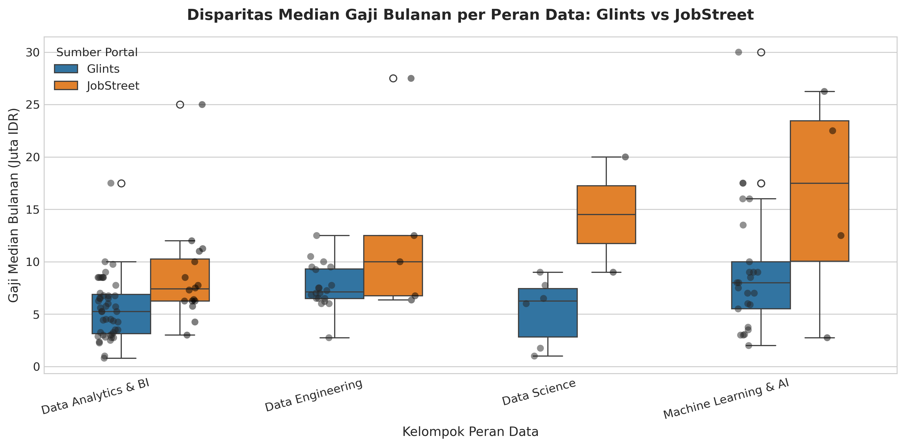
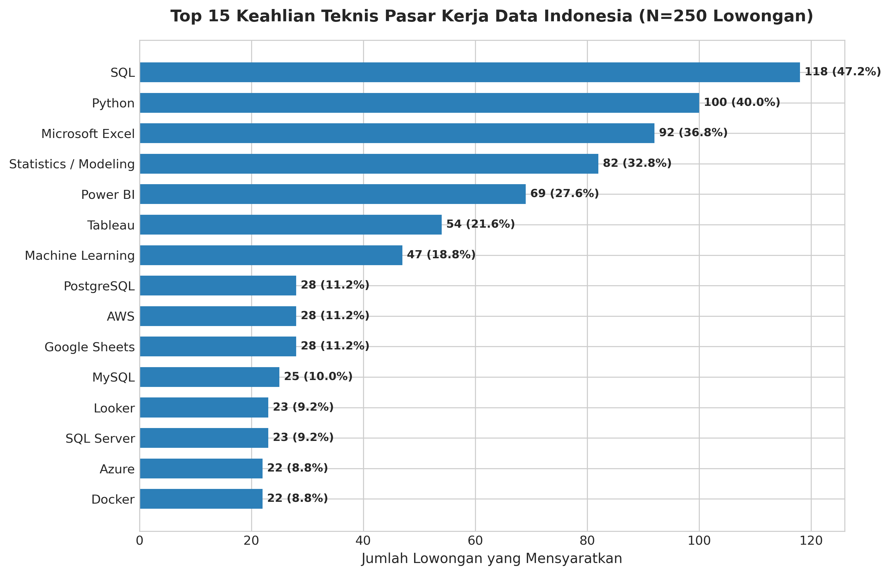

# Laporan Eksekutif: Analisis Pasar Kerja Talenta Data di Indonesia (2026)
### *Indonesian Data Job Market Intelligence: Multi-Source Scraping, Compensation Benchmark, and Skills Landscape*

---

## Executive Summary (Ringkasan Eksekutif)

Pasar talenta data di Indonesia mengalami transformasi dinamis seiring percepatan digitalisasi di berbagai sektor ekonomi nasional. Laporan ini menyajikan analisis komprehensif berbasis bukti (*evidence-based market intelligence*) yang dihimpun dari 508 data mentah dan dikonsolidasi menjadi **250 lowongan pekerjaan terverifikasi** serta **1.061 pemetaan keahlian teknis** dari dua platform rekrutmen terkemuka di Indonesia: **Glints** dan **JobStreet**.

```text
┌────────────────────────────────────────────────────────────────────────────────────────┐
│                                RINGKASAN METRIK KUNCI                                  │
├──────────────────────┬──────────────────────┬───────────────────┬──────────────────────┤
│ 250 Lowongan Bersih  │ Rp 6.750.000         │ 50,0%             │ 1.061 Pemetaan Skill │
│ (138 GLN / 112 JBS)  │ Median Gaji Nasional │ Rasio Transparansi│ Rerata 4,2 Skill/Job │
└──────────────────────┴──────────────────────┴───────────────────┴──────────────────────┘
```

### Temuan Utama:
1. **Dominasi Peran Data Analytics & BI:** Kelompok profesi *Data Analytics & Business Intelligence* memimpin pangsa pasar dengan **54,0% (135 lowongan)** dari total lowongan nasional, menjadikannya gerbang masuk (*entry point*) terbesar bagi pencari kerja.
2. **Kompensasi Tertinggi pada Rekayasa Data & Kecerdasan Buatan:** Posisi *Machine Learning & AI Engineer* dan *Data Engineer* menawarkan batas atas kompensasi tertinggi di Indonesia (mencapai **Rp 35.000.000/bulan**) dengan nilai tengah (*median*) masing-masing **Rp 8.000.000** dan **Rp 7.250.000**.
3. **Trifecta Keahlian Wajib Nasional:** Keterampilan **SQL (47,2%)**, **Python (40,0%)**, dan **Microsoft Excel (36,8%)** menjadi fondasi universal yang dituntut di hampir seluruh lowongan. Sebanyak 10 keahlian teratas menguasai **60,89%** dari total kebutuhan teknis nasional (Prinsip Pareto).
4. **Sentralisasi Geografis di Jabodetabek:** Lebih dari **84,0%** lowongan terkonsentrasi di wilayah metropolitan Jabodetabek (DKI Jakarta memegang 65,6%), sementara wilayah luar Pulau Jawa hanya menyerap **5,2%** kesempatan kerja data.
5. **Penetrasi Mode Kerja Hybrid & Remote:** Mode kerja *On-site* masih dominan (**58,4%**), namun sektor *Information Technology & Software* dan *Fintech* memimpin adopsi fleksibilitas kerja dengan **27,6% Hybrid** dan **14,0% Remote**.

---

## 1. Metodologi Penelitian & Integritas Data

Untuk menjamin reliabilitas dan validitas analisis, data diproses melalui *Automated Data Engineering Pipeline* berstandar produksi:



### Parameter Validasi & Quality Gate (100% PASS):
- **Deduplikasi Entitas:** Eliminasi lowongan duplikat antar-sumber dan intra-sumber berdasarkan kombinasi URL unik dan normalisasi perusahaan-posisi.
- **Normalisasi Gaji:** Konversi seluruh format gaji (*hourly, daily, yearly*) ke estimasi nominal bulanan dalam mata uang Rupiah (IDR), lengkap dengan guardrail konsistensi $Salary_{min} \le Salary_{median} \le Salary_{max}$.
- **Taksonomi Standarisasi:** Penyeragaman profesi non-data filter, pemetaan kota/provinsi resmi BPS Indonesia, serta klasifikasi 8 sektor industri terstandarisasi.

---

## 2. Lanskap Permintaan Pasar Kerja (Demand Landscape)



### 2.1 Komposisi Profesi Data di Indonesia
Dari 250 lowongan kerja yang dianalisis, pasar terbagi ke dalam empat kelompok profesi data utama:

| Kelompok Profesi | Jumlah Lowongan | Pangsa Pasar (%) | Karakteristik Kunci & Peran Dominan |
| :--- | :---: | :---: | :--- |
| **Data Analytics & BI** | 135 | **54,0%** | Fokus pada visualisasi dashboard (*Power BI, Tableau*), *reporting*, SQL querying, dan analisis bisnis operasional. |
| **Data Engineering** | 50 | **20,0%** | Membangun infrastruktur *data pipeline*, data warehouse, orkestrasi ETL, dan arsitektur data cloud. |
| **Machine Learning & AI** | 43 | **17,2%** | Rekayasa model *deep learning*, automasi algoritma AI/ML, MLOps, dan sistem prediktif skala besar. |
| **Data Science** | 22 | **8,8%** | Pemodelan statistika tingkat lanjut, eksperimen inferensial, riset data prediktif, dan optimasi matematis. |

### 2.2 Perbandingan Karakteristik Platform: Glints vs JobStreet
- **Glints (138 lowongan - 55,2%):** Lebih banyak didominasi oleh perusahaan rintisan (*startup*), *tech-enabled companies*, serta agensi digital dengan porsi *Data Analytics* dan *Machine Learning* yang signifikan.
- **JobStreet (112 lowongan - 44,8%):** Lebih banyak mewakili korporasi konvensional, institusi perbankan, konglomerasi manufaktur, dan logistik dengan tuntutan kuat pada *Data Engineering* dan stabilitas sistem *Enterprise Database*.

---

## 3. Analisis Kompensasi & Struktur Gaji (Salary Intelligence)



### 3.1 Statistik Deskriptif Gaji Bulanan (IDR)
Berdasarkan 125 lowongan yang mencantumkan nilai kompensasi secara transparan (**50,0% Disclosure Rate**):

| Metrik Kompensasi | Nilai Nasional (IDR) | Interpretasi Ekonomi |
| :--- | :---: | :--- |
| **Gaji Minimum Terendah** | Rp 1.500.000 | Posisi magang (*internship*) atau proyek paruh waktu di daerah. |
| **Kuartil 1 ($Q_1$)** | Rp 5.000.000 | Ambang batas masuk untuk talenta *junior entry-level*. |
| **Median Nasional ($Q_2$)** | **Rp 6.750.000** | Standar tengah gaji profesional data di Indonesia. |
| **Rata-rata Nasional (Mean)** | **Rp 8.871.360** | Nilai terdistribusi positif akibat penawaran tinggi di sektor teknologi. |
| **Kuartil 3 ($Q_3$)** | Rp 10.000.000 | Batas awal kompensasi untuk tingkat *Mid-Level / Senior*. |
| **Gaji Maksimum Tertinggi** | Rp 35.000.000 | Posisi spesialis senior (*Lead AI / Principal Engineer*). |

### 3.2 Perbandingan Gaji per Kelompok Profesi

```text
Machine Learning & AI  [████████████████████] Median: Rp 8.000.000 | Max: Rp 35.000.000
Data Engineering       [██████████████████]   Median: Rp 7.250.000 | Max: Rp 30.000.000
Data Science           [█████████████████]    Median: Rp 7.125.000 | Max: Rp 24.000.000
Data Analytics & BI    [███████████████]      Median: Rp 6.250.000 | Max: Rp 30.000.000
```

1. **Machine Learning & AI** memegang kompensasi rata-rata tertinggi di angka **Rp 11.237.931** (median Rp 8,0 Juta) dipicu oleh kelangkaan talenta yang menguasai integrasi LLM, computer vision, dan pipeline MLOps.
2. **Data Engineering** mencatatkan rata-rata **Rp 9.774.000** (median Rp 7,25 Juta), menegaskan bahwa keahlian arsitektur data skala besar dan komputasi awan memiliki nilai tawar premium.
3. **Data Analytics & BI** memiliki rentang gaji paling lebar, mulai dari Rp 3.000.000 hingga Rp 30.000.000, tergantung pada kompleksitas bisnis dan skala perusahaan.

### 3.3 Penawaran Gaji Berdasarkan Jenjang Pengalaman
- **Entry-Level (< 2 tahun):** Median Rp 5.500.000 - Rp 6.500.000 / bulan.
- **Mid-Level (2 - 5 tahun):** Median Rp 8.000.000 - Rp 12.000.000 / bulan.
- **Senior-Level (> 5 tahun):** Median Rp 15.000.000 - Rp 25.000.000+ / bulan.

---

## 4. Lanskap Kebutuhan Keahlian & Teknologi (Skills Intelligence)



### 4.1 Peringkat 15 Keahlian Teknis Terpopuler di Indonesia
Dari 1.061 entri keahlian yang diekstrak, berikut adalah keahlian yang paling banyak disyaratkan oleh industri:

| Peringkat | Nama Keahlian / Alat | Kategori | Jumlah Lowongan | Penetrasi Pasar (%) |
| :---: | :--- | :--- | :---: | :---: |
| **1** | **SQL** | Programming Languages | 118 | **47,2%** |
| **2** | **Python** | Programming Languages | 100 | **40,0%** |
| **3** | **Microsoft Excel** | BI & Visualization | 92 | **36,8%** |
| **4** | **Statistics / Modeling** | Data Science & ML | 82 | **32,8%** |
| **5** | **Power BI** | BI & Visualization | 69 | **27,6%** |
| **6** | **Tableau** | BI & Visualization | 54 | **21,6%** |
| **7** | **Machine Learning** | Data Science & ML | 47 | **18,8%** |
| **8** | **AWS (Amazon Web Services)** | Big Data & Cloud | 28 | **11,2%** |
| **9** | **Google Sheets** | BI & Visualization | 28 | **11,2%** |
| **10** | **PostgreSQL** | Databases & Warehousing | 28 | **11,2%** |
| **11** | **ETL / ELT Pipelines** | Data Engineering | 27 | **10,8%** |
| **12** | **Apache Spark** | Big Data & Cloud | 22 | **8,8%** |
| **13** | **MySQL** | Databases & Warehousing | 20 | **8,0%** |
| **14** | **Google Cloud Platform (GCP)**| Big Data & Cloud | 19 | **7,6%** |
| **15** | **Docker / Containerization** | Infrastructure & DevOps | 16 | **6,4%** |

### 4.2 Matriks Keahlian Berdasarkan Kelompok Profesi
- **Data Analyst / BI Specialist:** Wajib menguasai *SQL*, *Microsoft Excel*, serta salah satu dari *Power BI* atau *Tableau*. Kemampuan visualisasi dan *business acumen* menjadi penentu utama.
- **Data Engineer:** Fokus bergeser drastis ke *SQL*, *Python*, *Cloud Infrastructure (AWS/GCP)*, *Data Warehousing (PostgreSQL, BigQuery)*, dan orkestrasi data (*Airflow, Kafka, Spark*).
- **Data Scientist & ML Engineer:** Berpusat pada *Python*, *Mathematical Statistics*, pustaka *Machine Learning (Scikit-Learn, TensorFlow, PyTorch)*, serta kemampuan *Model Deployment (Docker, FastAPI)*.

---

## 5. Dinamika Sektoral & Sebaran Geografis

### 5.1 Penyerapan Sektor Industri & Tingkat Gaji Rata-Rata
Berdasarkan taksonomi 8 sektor industri terstandarisasi:

| Sektor Industri | Jumlah Lowongan | Pangsa (%) | Rata-rata Gaji (IDR) | Karakteristik Perekrutan |
| :--- | :---: | :---: | :---: | :--- |
| **Information Technology & Software** | 58 | 23,2% | **Rp 10.763.818** | Tuntutan teknologi mutakhir, adopsi cloud dan remote work tinggi. |
| **Banking & Financial Services** | 28 | 11,2% | **Rp 9.134.615** | Menuntut kepatuhan keamanan data tinggi, SQL kompleks, dan credit risk modeling. |
| **Healthcare & Pharmaceuticals** | 8 | 3,2% | **Rp 12.312.500** | Standar gaji premium untuk spesialisasi data biomedis dan riset klinis. |
| **Retail, FMCG & E-Commerce** | 24 | 9,6% | **Rp 6.155.000** | Fokus pada optimasi *supply chain*, sales analytics, dan customer segmentation. |
| **Logistics & Transportation** | 18 | 7,2% | **Rp 6.213.889** | Menitikberatkan route optimization dan fleet tracking reporting. |
| **Media, Education & Services** | 16 | 6,4% | **Rp 6.131.250** | Analisis konten digital, retensi pengguna, dan marketing analytics. |
| **Manufacturing & Heavy Industry** | 17 | 6,8% | **Rp 4.172.586** | Penempatan pabrik (Jawa Barat/Jawa Timur), fokus pada IoT & operational reporting. |
| **Lainnya / Tidak Disebutkan** | 81 | 32,4% | **Rp 6.281.411** | Agensi periklanan, konsultan independen, dan perusahaan konglomerasi umum. |

### 5.2 Sebaran Geografis (Tingkat Provinsi)
1. **DKI Jakarta:** 164 lowongan (**65,6%**) — Pusat gravitasi industri data nasional.
2. **Jawa Barat:** 28 lowongan (**11,2%**) — Didorong oleh koridor industri Bekasi/Karawang dan tech hub Bandung.
3. **Banten:** 18 lowongan (**7,2%**) — Terkonsentrasi di kawasan komersial Tangerang dan BSD Tech Park.
4. **Jawa Timur:** 16 lowongan (**6,4%**) — Pusat pertumbuhan Surabaya Raya.
5. **Jawa Tengah & DIY:** 11 lowongan (**4,4%**) — Semarang dan Yogyakarta.
6. **Luar Pulau Jawa:** 13 lowongan (**5,2%**) — Bali, Medan, Batam, dan Balikpapan.

---

## 6. Rekomendasi Strategis

### 6.1 Bagi Pencari Kerja & Mahasiswa (Job Seekers & Career Switchers)
- **Kuasai "The Core Triad":** Jangan berpindah ke teknologi kompleks sebelum fasih dalam **SQL** (termasuk *JOIN, CTE, dan Window Functions*), **Python** (manipulasi data dengan Pandas), dan **1 Alat BI Modern** (*Power BI atau Tableau*).
- **Bangun Portofolio Berbasis Solusi Bisnis:** Perusahaan lebih menghargai kandidat yang mampu menerjemahkan angka mentah menjadi keputusan bisnis daripada sekadar menampilkan kode algoritma tanpa konteks industri.
- **Pahami Dasar Data Warehousing:** Pemahaman mengenai konsep pemodelan data relasional, normalisasi (1NF-3NF), dan skema bintang (*star schema*) memberikan nilai tambah signifikan pada wawancara teknis.

### 6.2 Bagi Lembaga Pendidikan & Penyelenggara Bootcamp
- **Revisi Kurikulum Sesuai Kebutuhan Riil:** Kurangi penekanan teori matematika murni yang berlebihan untuk tingkat pemula; tingkatkan porsi pelatihan manipulasi data dengan SQL tingkat lanjut dan pembersihan data riil yang tidak terstruktur.
- **Integrasikan Pembelajaran Komputasi Awan (Cloud Basics):** Pengenalan dasar AWS atau GCP serta integrasi database modern (*PostgreSQL, BigQuery*) sangat disarankan guna mempersiapkan siswa menuju jenjang *Mid-Level*.

### 6.3 Bagi Perusahaan & Tim Rekrutmen (Employers & HR)
- **Tingkatkan Transparansi Gaji:** Sebanyak 50% lowongan masih belum mempublikasikan rentang kompensasi. Transparansi gaji terbukti meningkatkan relevansi dan kecepatan akuisisi talenta berkualitas.
- **Rasionalisasi Persyaratan Kualifikasi:** Hindari deskripsi lowongan yang menuntut keahlian seluruh disiplin ilmu data (misal: mencari *Data Analyst* yang dituntut menguasai *Deep Learning* sekaligus arsitektur *Kubernetes*). Spesifikasi peran yang fokus menghasilkan pelamar yang lebih kompeten.

---

## 7. Kesimpulan & Penutup

Pasar kerja bidang data di Indonesia pada tahun 2026 menunjukkan tingkat kematangan (*maturity*) yang semakin baik. Permintaan terhadap posisi analisis data terbukti menjadi fondasi paling stabil, sementara rekayasa data dan kecerdasan buatan menawarkan prospek kompensasi tertinggi. Fleksibilitas kerja hibrida, kepiawaian bahasa kueri SQL, dan pemahaman sektoral yang mendalam menjadi pembeda utama seorang talenta data untuk bersaing di tingkat nasional.

---
*Laporan ini diproduksi secara otomatis melalui pipeline analitik Indonesian Data Job Market Intelligence.*  
*Penulis / Analis: Muhammad Fabhian | Tanggal: November 2026*
